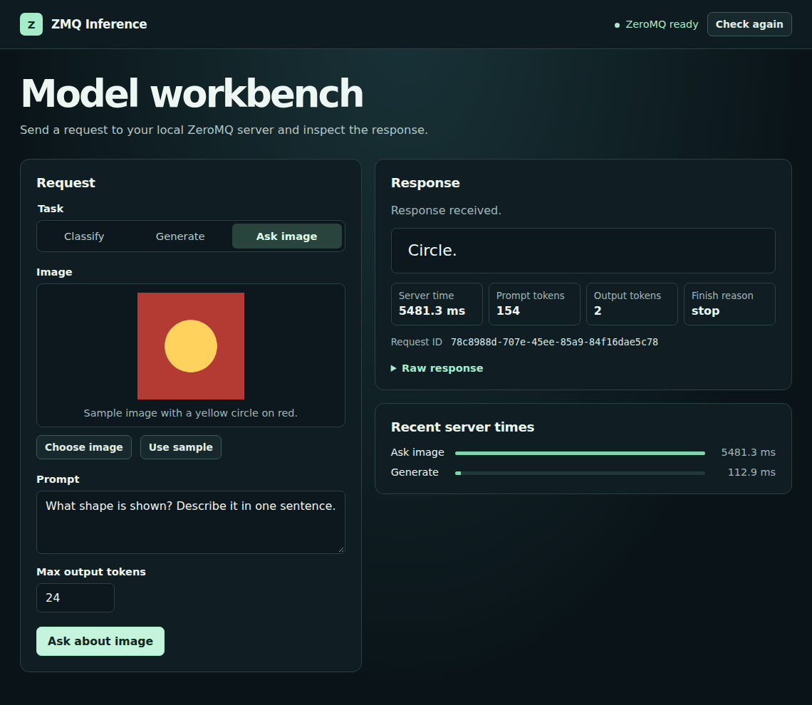
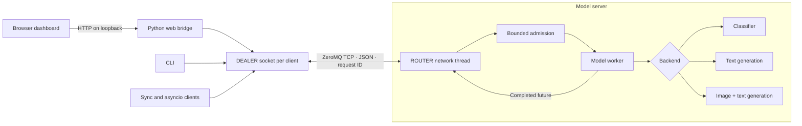

# ZMQ Inference

**Serve local vision and language models over ZeroMQ.** Classify images with PyTorch or TensorFlow, generate text with SmolLM2, and ask questions about images with SmolVLM. Use the same Python clients, CLI, or local browser dashboard.

[](https://pypi.org/project/zmq-vision/)
[](https://github.com/jamal-saeedi/zmq-vision/actions/workflows/ci.yml)
[](https://github.com/jamal-saeedi/zmq-vision/blob/main/LICENSE)

[Quick start](#quick-start) · [Browser dashboard](#browser-dashboard) · [Model examples](#serve-a-model) · [Python API](#python-api) · [Architecture](#architecture) · [Benchmarks](#benchmarks)

## Quick start

In a Python 3.10+ virtual environment:

```bash
python -m pip install --upgrade "zmq-vision>=0.5.0"
zmq-inference demo
```

The demo starts a real localhost TCP server, sends generated images using both Python clients, and checks the responses and shutdown. It ranks RGB channel intensity and runs without a model download or GPU. [GitHub release wheels](https://github.com/jamal-saeedi/zmq-vision/releases)

## Browser dashboard

```bash
zmq-inference web --demo
```

Open **http://127.0.0.1:8080**, choose **Use sample**, then run classification. The dashboard shows model scores, token usage when applicable, request IDs, and a chart of recent server times. The launcher works from a checkout with `./scripts/demo-web.sh`. To test an existing model server, use `zmq-inference web` or `./scripts/demo-web.sh --connect`.



The bridge listens on loopback and connects to ZeroMQ on port 5576 by default. Use `--port` for the dashboard port and `--zmq-port` for the model port. The three tasks map to **Classify** for demo, PyTorch, or TensorFlow, **Generate** for an LLM or VLM, and **Ask image** for a VLM.

## Serve a model

### Ask a question about an image

Install the optional VLM extra and download the matching SmolVLM-256M Instruct model and projector. The two quantized files total about 279 MB. Python 3.12 on Linux or WSL is the tested setup. If pip builds llama.cpp from source, it needs a C/C++ toolchain. [llama-cpp-python installation](https://llama-cpp-python.readthedocs.io/en/latest/#installation)

```bash
python -m pip install "zmq-vision[vlm]>=0.5.0"
base=https://huggingface.co/ggml-org/SmolVLM-256M-Instruct-GGUF/resolve/b9e4379657e1450d04d02eec8e345667265b0a00
curl -fL "$base/SmolVLM-256M-Instruct-Q8_0.gguf" -o smolvlm.gguf
curl -fL "$base/mmproj-SmolVLM-256M-Instruct-Q8_0.gguf" -o projector.gguf
zmq-inference serve --backend vlm --model-path smolvlm.gguf --projector-path projector.gguf
```

In another terminal, pass a local image:

```bash
zmq-inference generate "What is shown in this photo?" --image photo.jpg --async --json
```

Or run `zmq-inference web` and choose **Ask image**. The VLM accepts text-only requests too. The server uses two CPU threads and resizes images to fit 512 × 512 before model processing. The [SmolVLM weights](https://huggingface.co/ggml-org/SmolVLM-256M-Instruct-GGUF) use Apache 2.0.

### Generate text with a small LLM

```bash
python -m pip install "zmq-vision[llm]>=0.4.0"
curl -fL -o smollm2.gguf \
  https://huggingface.co/bartowski/SmolLM2-135M-Instruct-GGUF/resolve/09816acd5d99df7be770d85ea30822623dab342c/SmolLM2-135M-Instruct-Q4_K_M.gguf
zmq-inference serve --backend llm --model-path smollm2.gguf
```

From another terminal:

```bash
zmq-inference generate "Name three uses for a Raspberry Pi." --max-tokens 48
```

The text-only setup uses a 105 MB GGUF and two CPU threads. Generation returns text, prompt and output token counts, and a finish reason. Both GGUF backends run from local files. [Base model](https://huggingface.co/HuggingFaceTB/SmolLM2-135M-Instruct) · [Quantized weights](https://huggingface.co/bartowski/SmolLM2-135M-Instruct-GGUF) · [llama-cpp-python](https://github.com/abetlen/llama-cpp-python)

### Classify an image

```bash
python -m pip install "zmq-vision[torch]"
zmq-inference serve --backend torch --model mobilenetv2_100 --device cpu
```

From another terminal:

```bash
zmq-inference infer photo.jpg --async --json
```

For TensorFlow, install `zmq-vision[tf]` and use `zmq-inference serve --backend tf --device cpu`. The supplied classifiers download pretrained weights on first use. [Custom backend example](https://github.com/jamal-saeedi/zmq-vision/blob/main/examples/custom_backend.py)

## Python API

Both clients support `ping()`, `infer(image)`, and `generate(prompt, image=...)`. The `image` argument is optional for generation.

```python
import asyncio

from zmq_inference.client.async_client import AsyncClient


async def main():
    async with AsyncClient() as client:
        result = await client.generate("What is in this photo?", image="photo.jpg", max_tokens=48)
        if not result.ok:
            raise RuntimeError(result.error)
        print(result.generation.text)


asyncio.run(main())
```

Use a VLM server for the example above. Import `SyncClient` from `zmq_inference.client` for the synchronous equivalent. The PyPI package is still published as `zmq-vision`, and both CLI names work. [Migration guide](https://github.com/jamal-saeedi/zmq-vision/blob/main/docs/migration.md)

## Architecture



- **Bounded admission.** One thread owns the ROUTER socket. The worker pool handles inference. Once 16 requests are running or queued, the default server returns a busy response.
- **Correlated replies.** Every response carries a request ID. Timeout and async cancellation replace the client socket so late replies cannot be mistaken for a later result.
- **Predictable lifecycle.** Readiness follows model load and bind. Shutdown stops admission and drains active work.

[Wire format, limits, and delivery semantics](https://github.com/jamal-saeedi/zmq-vision/blob/main/docs/architecture.md)

## Benchmarks

On WSL2, single-client RGB demo p95 fell from **56.5 ms to 3.3 ms** in 0.4. SmolLM2 delivered **98 output tokens/s** on two CPU threads. The benchmark guide also covers MobileNet and SmolVLM, with commands and raw results. [Benchmark guide](https://github.com/jamal-saeedi/zmq-vision/blob/main/docs/benchmarks.md)

## Contribute

Built by [Jamal Saeedi](https://github.com/jamal-saeedi). Fork the repo to try another model or extend the transport.

[Star on GitHub](https://github.com/jamal-saeedi/zmq-vision) · [Fork](https://github.com/jamal-saeedi/zmq-vision/fork) · [Report an issue](https://github.com/jamal-saeedi/zmq-vision/issues) · [Contributing guide](https://github.com/jamal-saeedi/zmq-vision/blob/main/CONTRIBUTING.md)
