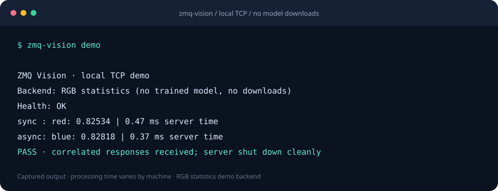
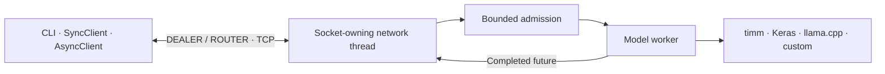

# ZMQ Vision

**Serve image models and small local LLMs over ZeroMQ.** Run a model in its own process and call it from Python, asyncio, or the CLI. The core install is lightweight. Add PyTorch, TensorFlow, or llama.cpp when you need it.

[](https://pypi.org/project/zmq-vision/)
[](https://github.com/jamal-saeedi/zmq-vision/actions/workflows/ci.yml)
[](https://github.com/jamal-saeedi/zmq-vision/blob/main/LICENSE)

[Quick start](#quick-start) · [Models](#serve-a-model) · [Python API](#python-api) · [Design](#how-it-works) · [Benchmarks](#benchmarks)

## Quick start

In a Python 3.10+ virtual environment:

```bash
python -m pip install zmq-vision
zmq-vision demo
```

The demo starts a real localhost TCP server, checks readiness, sends one image from each Python client, and shuts down. It ranks RGB channel intensity, so you can exercise the full transport without model weights or a GPU.



Use `zmq-vision demo --json` for machine-readable output or `zmq-vision doctor` to inspect installed runtime versions.
You can also install a wheel from [GitHub Releases](https://github.com/jamal-saeedi/zmq-vision/releases).

## Serve a model

### Generate text on CPU

Install the optional backend and download the 105 MB SmolLM2-135M Instruct GGUF. Python 3.12 on Linux or WSL is the tested setup. If pip builds llama.cpp from source, it needs a C/C++ toolchain. See [llama-cpp-python installation](https://llama-cpp-python.readthedocs.io/en/latest/#installation).

```bash
python -m pip install "zmq-vision[llm]>=0.4.0"
curl -fL -o smollm2.gguf \
  https://huggingface.co/bartowski/SmolLM2-135M-Instruct-GGUF/resolve/09816acd5d99df7be770d85ea30822623dab342c/SmolLM2-135M-Instruct-Q4_K_M.gguf
zmq-vision serve --backend llm --model-path smollm2.gguf
```

In another terminal:

```bash
zmq-vision health
zmq-vision generate "Name three uses for a Raspberry Pi." --max-tokens 48
zmq-vision generate "Name three primary colors." --async --json
```

The server reads a local ChatML-compatible GGUF, uses two CPU threads by default, and returns the answer with prompt and completion token counts. Prompts and inference stay on the serving machine when both ends run on localhost. No API key is required. The [base model](https://huggingface.co/HuggingFaceTB/SmolLM2-135M-Instruct) and [quantized weights](https://huggingface.co/bartowski/SmolLM2-135M-Instruct-GGUF) use Apache 2.0. [llama-cpp-python](https://github.com/abetlen/llama-cpp-python) uses MIT.

### Classify an image

```bash
python -m pip install "zmq-vision[torch]"
zmq-vision serve --backend torch --model mobilenetv2_100 --device cpu
```

From another terminal, pass any local image:

```bash
zmq-vision infer photo.jpg --async --json
```

For TensorFlow, install `zmq-vision[tf]` and run `zmq-vision serve --backend tf --device cpu`. PyTorch uses timm ImageNet-1k models and TensorFlow uses Keras MobileNet. Both download pretrained weights on the first run. [Bring your own image model](https://github.com/jamal-saeedi/zmq-vision/blob/main/examples/custom_backend.py) by implementing `load_model`, `preprocess`, and `predict`.

## Python API

`SyncClient` and `AsyncClient` both support `ping()`, `infer(image)`, and `generate(prompt)`. Connect to the server running the corresponding backend.

```python
from zmq_inference.client import SyncClient

with SyncClient() as client:
    result = client.infer("photo.jpg")
    if not result.ok:
        raise RuntimeError(result.error)
    print(result.predictions[0])
```

```python
import asyncio

from zmq_inference.client.async_client import AsyncClient


async def main():
    async with AsyncClient() as client:
        result = await client.generate("What is a message queue?", max_tokens=48)
        if not result.ok:
            raise RuntimeError(result.error)
        print(result.generation.text)


asyncio.run(main())
```

Both examples use `127.0.0.1:5576`. Pass a `ClientConfig` or CLI `--host` and `--port` to connect elsewhere. The `zmq_inference` import, `zmq-inference` command alias, and 0.3 image wire format remain supported. [Configuration and migration](https://github.com/jamal-saeedi/zmq-vision/blob/main/docs/migration.md)

## How it works



- **Backpressure.** One thread owns the ROUTER socket. Model workers handle inference off that thread. The server admits at most 16 running or queued requests by default and sends a busy response when full.
- **Response correlation.** Every response carries a request ID. Clients replace their socket after a timeout or async cancellation, so a late response cannot be mistaken for a later result.
- **Lifecycle.** Readiness means the model has loaded and the socket has bound. Shutdown stops admission and drains active model work.
- **Deployment.** Each server runs one backend. Text generation is single-turn and returns one complete response. The protocol defaults to loopback and assumes a trusted network or secured tunnel for remote use.

[Wire format, defaults, and delivery semantics](https://github.com/jamal-saeedi/zmq-vision/blob/main/docs/architecture.md)

## Benchmarks

On WSL2, single-client p95 for the RGB demo fell from **56.5 ms to 3.3 ms** between 0.3 and 0.4. SmolLM2 delivered **98 output tokens/s** with one client and two CPU threads. Run `python scripts/benchmark.py` from an installed source checkout to measure your machine.

[Measured results and reproduction commands](https://github.com/jamal-saeedi/zmq-vision/blob/main/docs/benchmarks.md)

## Contribute

Built by [Jamal Saeedi](https://github.com/jamal-saeedi). Fork the repo to try a different model or improve the transport.

[Star on GitHub](https://github.com/jamal-saeedi/zmq-vision) · [Fork](https://github.com/jamal-saeedi/zmq-vision/fork) · [Report an issue](https://github.com/jamal-saeedi/zmq-vision/issues) · [Contributing guide](https://github.com/jamal-saeedi/zmq-vision/blob/main/CONTRIBUTING.md)
