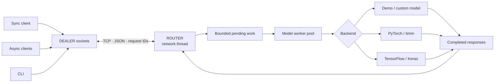

<p align="center">
  
</p>

<p align="center">
  <a href="https://github.com/jamal-saeedi/zmq-vision-server/actions/workflows/ci.yml"></a>
  
  
  <a href="LICENSE"></a>
</p>

# ZMQ Vision

**Serve image models over ZeroMQ with the same synchronous, asynchronous, and command-line clients.**

A small Python library that separates model execution from messaging. Run an ImageNet classifier with PyTorch/timm or TensorFlow/Keras, or implement three methods to serve your own image model. The core package needs only PyZMQ, Pillow, and Click.

Built by [Jamal Saeedi](https://github.com/jamal-saeedi). This project demonstrates transport design, bounded concurrency, model integration, Python packaging, and tests against real TCP sockets.

[Quick start](#quick-start) · [Model backends](#use-a-trained-model) · [Python API](#python-api) · [Architecture](#architecture) · [Development](#development)

## Quick start

Python 3.10 or newer; a virtual environment is recommended.

```bash
git clone https://github.com/jamal-saeedi/zmq-vision-server.git
cd zmq-vision-server
python -m venv .venv
# Linux / macOS
source .venv/bin/activate
# Windows PowerShell: .venv\Scripts\Activate.ps1
python -m pip install --upgrade pip
python -m pip install .
zmq-vision demo
```

The demo starts a server on an available localhost TCP port, checks readiness, sends generated images through both clients, checks their responses, and shuts down. It downloads no weights and needs no GPU. Its backend ranks mean RGB intensity; it is **not a trained classifier**.

<p align="center">
  
</p>

The image is captured from a real run; timings vary by machine. Run `zmq-vision demo --json` for inspectable output or `zmq-vision doctor` for installed versions.

Install directly from GitHub without cloning:

```bash
python -m pip install "git+https://github.com/jamal-saeedi/zmq-vision-server.git"
```

The distribution is named `zmq-vision`. PyPI publication is a separate release step; the source install above works before publication. Existing `zmq_inference` imports and the `zmq-inference` command remain supported. See [migration notes](docs/migration.md).

## Use a trained model

Choose one extra; neither ML framework is required by the core package.

| Backend | Install from this checkout | Model | First run |
| --- | --- | --- | --- |
| Demo | `python -m pip install .` | Mean RGB intensity | Offline |
| PyTorch | `python -m pip install ".[torch]"` | ImageNet-1k models from timm | Downloads weights |
| TensorFlow | `python -m pip install ".[tf]"` | Keras MobileNet | Downloads weights |

```bash
# Terminal 1: PyTorch, CPU
zmq-vision serve --backend torch --model mobilenetv2_100 --device cpu

# Terminal 2
zmq-vision health
zmq-vision infer examples/sample.png
zmq-vision infer examples/sample.png --async --json
```

Or start TensorFlow with `zmq-vision serve --backend tf --device cpu`.

For a fully offline transport example, use `zmq-vision serve --backend demo`, then send any image. `--no-pretrained` is available for ML smoke tests; randomly initialized model predictions are not meaningful. Framework and model-weight licenses apply separately. CPU/GPU installation and Python support depend on the selected framework's wheels; use Python 3.12 for the tested ML configuration.

## Python API

### Synchronous

```python
from zmq_inference import ClientConfig
from zmq_inference.client import SyncClient

with SyncClient(ClientConfig(host="127.0.0.1", port=5576, timeout_ms=5000)) as client:
    assert client.ping().ok
    response = client.infer("examples/sample.png")
    if not response.ok:
        raise RuntimeError(response.error)
    for prediction in response.predictions:
        print(prediction.label, prediction.confidence)
```

### Asynchronous

```python
import asyncio
from zmq_inference.client.async_client import AsyncClient


async def main():
    async with AsyncClient() as client:
        response = await client.infer("examples/sample.png")
        print(response)


asyncio.run(main())
```

One async client serializes its exchanges so concurrent callers cannot consume each other's replies. Use multiple clients for concurrent server requests. A synchronous client belongs to the thread that connected it.

### Your own backend

Implement `load_model()`, `preprocess(image)`, and `predict(input)` on `BaseInferenceServer`. Transport, validation, error responses, queue limits, and lifecycle are provided. See the complete [custom backend example](examples/custom_backend.py).

```python
from zmq_inference import ServerConfig
from zmq_inference.server.demo_server import DemoInferenceServer

server = DemoInferenceServer(ServerConfig(port=5576))
server.start()
try:
    server.wait_until_ready(timeout=10)  # surfaces model-load and bind errors
    server.join()
except KeyboardInterrupt:
    pass
finally:
    server.stop()
    server.join()
```

## Architecture



- **Socket ownership:** only the network thread touches the server socket. Workers return results through futures.
- **Bounded work:** one model worker and at most 16 accepted requests by default; overload returns an explicit busy response. Increase workers only for a thread-safe backend.
- **Response correlation:** clients match request IDs and replace their socket after a timeout or cancellation. Late replies cannot be returned as the next request's result.
- **Predictable lifecycle:** readiness means the model loaded and TCP bound. Shutdown stops admission, cancels queued work, and waits for active predictions.
- **Model preprocessing:** PyTorch uses the model's timm data configuration; TensorFlow uses MobileNet preprocessing and bundled ImageNet labels.

The earlier ROUTER/DEALER in-process proxy and thread-per-request design have been replaced. The client/server TCP connection still uses DEALER/ROUTER. [Protocol and limits](docs/architecture.md) cover delivery semantics and tradeoffs.

## Configuration

Explicit Python arguments or CLI options override environment defaults. `.env` files are not loaded automatically; `.env.example` documents variables you can export.

| Variable | Default | Used by |
| --- | --- | --- |
| `ZMQ_HOST` | `127.0.0.1` | Server bind host |
| `ZMQ_SERVER_HOST` | `127.0.0.1` | Client destination |
| `ZMQ_PORT` | `5576` | Both |
| `ZMQ_MODEL` | `mobilenetv2_100` | PyTorch model |
| `ZMQ_DEVICE` | `auto` | `auto`, `cpu`, or `cuda` |
| `ZMQ_TIMEOUT_MS` | `30000` | Client timeout per attempt |

Use `zmq-vision serve --help` and `zmq-vision infer --help` for options. Python `ServerConfig` also exposes message and decoded-image limits: 8 MiB per frame and 16 million pixels by default. Oversized frames are disconnected by libzmq; the client reaches its timeout. `--top-k` on `infer` limits displayed results; `serve --top-k` controls how many predictions are returned.

Defaults bind to localhost. For a trusted LAN, explicitly use `--host 0.0.0.0`; clients specify the server's address. This protocol has no built-in authentication or encryption. Use a secured private network or tunnel for remote traffic.

## Development

```bash
python -m pip install -e ".[dev]"
python -m pytest -m "not torch and not tf"
ruff check .
ruff format --check .
python -m build
python -m twine check dist/*
```

Optional real-model tests (CPU, random weights, no downloads):

```bash
python -m pip install -e ".[torch,tf,dev]"
python -m pytest tests/test_backends.py
# Also download and exercise pretrained weights:
ZMQ_VISION_TEST_PRETRAINED=1 python -m pytest tests/test_backends.py
```

Core CI covers Python 3.10–3.14 on Linux, with additional Windows and macOS jobs. Separate jobs exercise both ML backends on Python 3.12. Distribution checks install a built wheel in a new environment and run the demo outside the checkout. See the [recorded validation](docs/validation.md), [contributing guide](CONTRIBUTING.md), and [release instructions](docs/releasing.md).

```text
src/zmq_inference/        Installable library; legacy import name preserved
  cli/                   serve, infer, health, demo, doctor
  client/                Synchronous and asyncio transports
  core/                  Configuration, protocol, logging
  server/                Shared lifecycle and optional model backends
  data/                  Bundled ImageNet labels
  utils/                 Image serialization and resource loading
examples/                Runnable custom backend and original sample image
  legacy/                Archived 2024 scripts; separate wire protocol
tests/                   Unit, real TCP, CLI, and optional ML tests
docs/                    Architecture, migration, release guide, visual assets
.github/workflows/       Checks, tagged GitHub releases, manual PyPI publishing
```

## Scope and limitations

This is an image inference transport library. It does not train models, batch requests, guarantee exactly-once execution, or provide multi-host scheduling. Retries can repeat inference; treat custom predictors as side-effect free. Health checks share worker admission and may time out under load. A hung model call can delay shutdown because Python cannot safely kill its thread.

A language model is not included: text generation needs a text protocol, token limits, and different response semantics. Adding a small LLM without that design would dilute the working vision interface. The backend extension point supports future image-oriented models without making their dependencies mandatory.

## Troubleshooting

| Symptom | Check |
| --- | --- |
| Timeout | `zmq-vision health --host HOST --port PORT`; confirm server readiness, firewall, and model load |
| Missing backend | Install the corresponding `[torch]` or `[tf]` extra |
| Address already in use | Choose another `--port`; startup failures return a nonzero exit status |
| Unexpected model result | Use pretrained weights, an ImageNet-1k model, and a suitable input image |
| Runtime / GPU failure | Run `zmq-vision doctor`, try `--device cpu`, and verify framework installation |
| Server busy | Reduce concurrent clients or size `--max-pending` for your deployment |

## License

[MIT](LICENSE). Original sample image and ImageNet label mapping are retained from this repository's earlier versions; their original upstream provenance was not recorded. See [asset notes](docs/assets.md).
